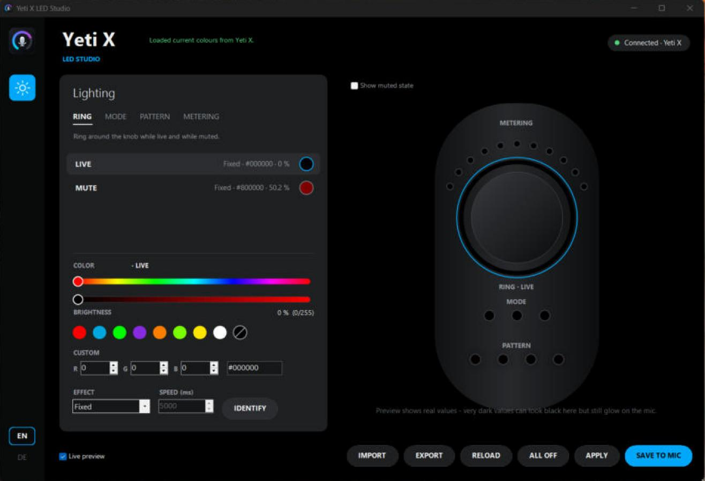

# Yeti X LED Studio

Set every LED of a **Blue Yeti X** microphone to any colour and brightness – down to 1/255 – without the limits of the Logitech G HUB lighting page. Turn LEDs completely off, make the mute ring a barely visible dark red, and store the result on the microphone.



> **Unofficial project.** Not affiliated with, endorsed or supported by Logitech or Blue Microphones. "Yeti X", "Blue" and "G HUB" are trademarks of their respective owners. The app uses G HUB's local, undocumented interface, so a G HUB update may break it. Use at your own risk.

## Why

G HUB clamps the Yeti X colours: the darkest grey it allows is `#595959`, there is no "off", and several zones (pattern indicators, breathing mute ring) cannot be fully darkened from the UI. This tool talks to the same local G HUB service the G HUB window uses and sends exact RGB values.

## Features

- All 12 lighting zones: ring (live / mute), mode indicators, polar pattern indicators, level meter (normal / high / peak)
- Hue spectrum, brightness slider with 1/255 steps, presets, exact RGB / hex input
- Fixed or breathing effect (where the device supports it) with adjustable speed
- **Identify**: flashes one zone white for 2 s so you can see which LED it is
- Live preview of the mic (including muted state); click an LED in the preview to edit it
- **Save to mic** – stores the lighting on the device
- Import / export presets as JSON
- English (default) and German UI, dark G HUB-style design

## Requirements

- Windows 10/11
- Logitech G HUB installed and running (it provides the local service on `127.0.0.1:9010`)
- Blue Yeti X connected via USB
- Windows PowerShell 5.1 (built into Windows)

## Install

1. Download this repository (**Code → Download ZIP**) and extract it.
2. Open PowerShell in the extracted folder and run:

   ```powershell
   powershell -ExecutionPolicy Bypass -File .\install.ps1
   ```

3. Start **Yeti X LED Studio** from the desktop or the Start menu.

The installer copies the app to `%LOCALAPPDATA%\YetiX-LED-Tool`, compiles the small launcher (`launcher\Launcher.cs`) locally with the C# compiler that ships with Windows, and creates the shortcuts. No admin rights, nothing is downloaded. Use `-NoDesktopShortcut` to skip the desktop icon.

Run without installing:

```powershell
powershell -ExecutionPolicy Bypass -STA -File .\app\YetiX-LED-Tool.ps1
```

Uninstall:

```powershell
powershell -ExecutionPolicy Bypass -File .\uninstall.ps1
```

## Usage tips

- Very dark values (e.g. `#040404`) look black on screen but still glow on the mic. Some LEDs switch fully off below a certain value – use **Identify** and small steps to find the darkest visible setting.
- With **Live preview** on, every change is sent immediately. **Save to mic** additionally stores the setting on the device.
- Clicking colours on G HUB's own lighting page afterwards overwrites the values with G HUB's limited ones.

## Privacy and security

- The app only connects to `127.0.0.1:9010` (G HUB on your own PC). It opens no ports and sends nothing to the internet.
- The only file it writes on its own is `%LOCALAPPDATA%\YetiX-LED-Tool\settings.json` (UI language), plus preset files you export yourself.
- Preset files and replies from the local service are validated (hex format, allowed effects, value ranges, size limit).
- `-ExecutionPolicy Bypass` only applies to the started script; it does not change your system policy.

## Project layout

| Path | Content |
| --- | --- |
| `app/YetiX-LED-Tool.ps1` | The app (WinForms UI + G HUB client) |
| `app/logo.ico`, `app/logo.png` | App icon |
| `launcher/Launcher.cs` | Tiny launcher that starts the script without a console window |
| `tools/make_logo.ps1` | Regenerates the logo |
| `tools/shortcut.ps1` | Shortcut helper used by the installer |
| `install.ps1`, `uninstall.ps1` | Install / remove for the current user |

## Deutsch (Kurzfassung)

Inoffizielles Tool, um alle LEDs des Blue Yeti X frei einzustellen (auch komplett aus oder extrem dunkel) – ohne die Grenzen von G HUB. G HUB muss laufen. Installation: ZIP herunterladen, entpacken, `powershell -ExecutionPolicy Bypass -File .\install.ps1` ausführen. Die Sprache lässt sich unten links auf **DE** umstellen.

## License

[MIT](LICENSE)
